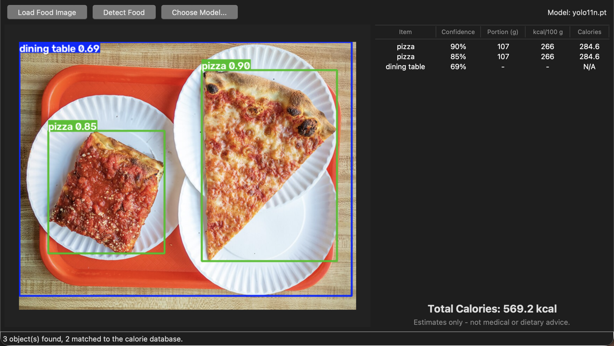

# Food Detection and Calorie Estimation

A Python desktop app that detects food in a photo with YOLO and estimates calories from a lookup table. The GUI is Tkinter.



This is an educational prototype. Detection and portion sizes are approximate, and the results are not medical or dietary advice.

## How it works

1. **Load Food Image** opens a JPG, JPEG, PNG, BMP or WEBP file with Pillow and converts it to RGB.
2. **Detect Food** runs Ultralytics YOLO on a background thread so the window stays responsive.
3. Each detected class name is normalized (`Hot_Dog` becomes `hot dog`, `doughnut` becomes `donut`) and looked up in `calorie_data.py`.
4. Calories = kcal per 100 g x assumed portion (g) / 100. Example: rice is 130 kcal/100 g x 180 g / 100 = **234 kcal**.
5. The annotated image, a per-item table and the total are shown. Labels that aren't in the database show `N/A` and are left out of the total.

## Which foods are recognized

The default `yolo11n.pt` model is trained on COCO, which has only 10 food classes: **apple, banana, orange, broccoli, carrot, sandwich, hot dog, pizza, donut, cake**. All 10 are in the calorie table.

Dishes like rice, idli, dosa, chapati, dal, curry and biryani are also in the table, but they need a **food-trained model**. Put its weights at `models/best.pt` and the app loads it automatically, or pick a `.pt` file with **Choose Model...**. Its class names must match the keys in `calorie_data.py`, or be added to `ALIASES`.

## Setup (Windows)

Double-click `run_windows.bat`, or run these commands manually:

```bat
py -3.11 -m venv venv
venv\Scripts\activate
python -m pip install --upgrade pip
python -m pip install -r requirements.txt
python app.py
```

## Setup (macOS / Linux)

```bash
python3 -m venv venv && source venv/bin/activate
python -m pip install -r requirements.txt
python app.py
```

On macOS with Homebrew Python, Tkinter needs a separate package: `brew install python-tk@3.12` (match your Python version).

The YOLO weights (about 5 MB) download automatically on the first detection.

## Project structure

```
Food_Calorie_Detection_Tkinter/
├── app.py                 # Tkinter GUI and detection workflow
├── calorie_data.py        # Calorie table, portion sizes, estimation helpers
├── requirements.txt
├── run_windows.bat        # One-click Windows setup and run
├── tests/                 # pytest tests for the calorie logic
├── docs/                  # Project documentation (.docx) and screenshot
├── models/                # Optional food-trained weights (best.pt)
└── sample_images/         # Put your test images here
```

## Tests

```bash
python -m pip install pytest
python -m pytest
```

## Troubleshooting

- **`No module named 'ultralytics'`**: the venv isn't active. Activate it and reinstall the requirements.
- **`WinError 1114` loading `c10.dll`**: run `python -c "import sys; print(sys.executable)"`. It must point to `venv\Scripts\python.exe`, not Anaconda. If it still fails, install the latest Microsoft Visual C++ Redistributable (x64), then reinstall torch: `python -m pip install --force-reinstall torch torchvision`.
- **Nothing matched**: the general model doesn't know that food. Use a food-trained model (see above).

## Credits

Screenshot photo: "L&B Spumoni Gardens pizza" by [Rhododendrites](https://commons.wikimedia.org/wiki/User:Rhododendrites), [CC BY-SA 4.0](https://creativecommons.org/licenses/by-sa/4.0), via Wikimedia Commons. Detection by [Ultralytics YOLO](https://docs.ultralytics.com/) (AGPL-3.0).
